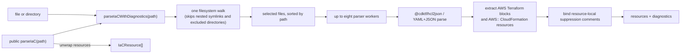

# SDK Architecture (`packages/sdk`)

## CloudBurnClient Facade

```mermaid
  classDiagram
  class CloudBurnClient {
    +scanStatic(path: string, config?: Partial~CloudBurnConfig~, options?: { configPath?: string }) Promise~ScanResult~
    +discover(options?: { target?: AwsDiscoveryTarget, config?: Partial~CloudBurnConfig~, configPath?: string, timeoutMs?: number, signal?: AbortSignal }) Promise~ScanResult~
    +initializeDiscovery(options?: { region?: string, timeoutMs?: number, signal?: AbortSignal }) Promise~AwsDiscoveryInitialization~
    +getDiscoveryStatus(options?: { region?: string, timeoutMs?: number, signal?: AbortSignal }) Promise~AwsDiscoveryStatus~
    +listSupportedDiscoveryResourceTypes(options?: AwsDiscoveryExecutionOptions) Promise~AwsSupportedResourceType[]~
    +loadConfig(path?: string) Promise~CloudBurnConfig~
  }
```

`CloudBurnClient` is the primary public entry point. Static IaC scans go through `scanStatic()` and live AWS scans go
through `discover()`. Applications select the rules that fit their use case with mode configuration and can request
generic evaluation evidence with `includeEvaluationResources`. The SDK owns rule execution, normalized findings,
generic rule metadata, and evaluated-resource projection; applications own product profiles and presentation policy.

`scanStatic()` and `discover()` can accept runtime config overrides plus an explicit `configPath`. When the effective
mode config sets `failOn`, the facade evaluates it after the engine returns and attaches the threshold, qualifying
count, and violation status to `ScanResult.policy`.

### Module loading

The SDK entry point keeps region validation and credential scoping in lightweight modules. Region validators remain
synchronous, and `withAwsClientCredentials()` returns its callback's Promise without resolving credentials. Static scans,
metadata access, and config loading do not import AWS clients or credential providers.

Live facade methods load the AWS client, request, cache, and discovery modules inside managed execution. The deadline and
cancellation signal cover that loading; each import continuation checks cancellation before starting work. Node may finish
an import after cancellation, but its continuation cannot resolve credentials or dispatch requests. The shared credential
scope remains available to lazily loaded clients, including calls wrapped in the public credential helper.

Both ESM and CommonJS builds split the live graph into internal chunks. Package export paths and method signatures stay
unchanged, and the published `dist/` directory includes those chunks. See the [startup benchmark](../reference/startup-benchmarks.md)
for the measured cost and reproduction command.

## Engine Flow

```mermaid
graph TD
  subgraph Static["runStaticScan(path, config)"]
    SR[buildRuleRegistry] --> SD[collect staticDependencies]
    SD --> SRg[resolve static dataset registry entries]
    SRg --> SP[parseIaCWithDiagnostics(required sourceKinds)]
    SP --> SL[load required static datasets and suppression targets]
    SL --> SC[build StaticEvaluationContext]
    SC --> SE["rule.evaluateStatic() => Finding | null"]
    SE --> SX[partition active and suppressed matches]
    SX --> SG[groupFindingsByProvider]
    SG --> SOut["ScanResult { providers, suppressed?, diagnostics? }"]
  end

  subgraph Live["runLiveScan(config, target, options)"]
    LR[buildRuleRegistry] --> LD[collect discoveryDependencies]
    LD --> LRg[resolve dataset registry entries]
    LRg --> LC[buildAwsDiscoveryCatalog]
    LRg --> AL[load independent account datasets]
    LC -->|complete type scope| LL[load dependency-ready datasets]
    AL --> RP[optional provisional rule evaluation]
    LL --> RP
    LC --> LX[build final LiveEvaluationContext]
    AL --> LX
    LL --> LX
    LX --> LE["rule.evaluateLive() => Finding | null"]
    LE --> LA{includeEvaluationResources?}
    LA -->|yes| LP[project normalized resources and rule status]
    LA -->|no| LG[groupFindingsByProvider]
    LP --> LG
    LG --> LOut["ScanResult { providers, evaluations? }"]
  end
```

[Live scan](live-scan.md#live-scan) owns the live steps and current discovery behavior;
[live metric evidence](live-metrics.md) owns ELB request activity and CloudWatch metric collection.

### Static Scan

1. Build the rule registry.
2. Collect unique `staticDependencies` from active static rules.
3. Resolve those dataset keys through the AWS static dataset registry.
4. Union required IaC source kinds from the resolved dataset definitions.
5. Parse only the required Terraform and CloudFormation inputs through
   `parseIaCWithDiagnostics` and retain non-fatal skipped-file diagnostics.
6. Group Terraform resources by module directory and CloudFormation resources by template file. Load the requested normalized static datasets separately for each scope.
7. Build `StaticEvaluationContext` with `{ resources: StaticResourceBag }`.
8. Invoke each static evaluator.
9. Match parsed resource-local suppression directives against each resource finding.
10. Group active rule findings under `providers -> rules -> findings`, retain suppressed matches under `suppressed`,
    and attach parser diagnostics when present.

Static scans walk the filesystem once for all selected source formats and parse at most eight files concurrently. Nested symlink files and directories are skipped, including dangling links and cycles; an explicitly selected symlink root is resolved while source locations retain its requested name. The walk also excludes `.git`, `.terraform`, and `node_modules` directories.

Terraform S3 lifecycle, tiering, and versioning resources and ECR lifecycle policies are indexed by reference before bucket or repository analysis. Alias matches preserve policy source order.

Static rule evaluation retains those scopes, including joins between datasets such as DynamoDB tables and autoscaling targets. Findings from each scope are merged under one rule result. Public resource IDs and source locations stay unchanged, and inline suppression matching still uses the source path and resource ID.

## Public Result Shape

See [`docs/reference/scan-result.md`](../reference/scan-result.md) for the full scan result contract.

## Parser Layer



The package-root `parseIaC(path, { sourceKinds? })` helper preserves its
`IaCResource[]` return contract. Static orchestration uses the internal
`parseIaCWithDiagnostics(path, { sourceKinds? })` entrypoint to receive
`{ resources, diagnostics }`. Both accept a Terraform file, CloudFormation
template, or directory, can limit parsing to the source kinds required by active
static datasets, ignore unsupported files, and preserve stable ordering. The
internal entrypoint reports malformed or oversized supported inputs as skipped;
raw parser errors are discarded so diagnostics cannot expose source excerpts or
absolute filesystem paths.
Terraform and CloudFormation files larger than 5 MiB are skipped, and Terraform source locations come from a single lexer pass that recognizes `resource` headers only at top level outside heredocs, comments, and strings.

Terraform line comments (`#` and `//`), Terraform block comments, and CloudFormation YAML comments can carry
`cloudburn-ignore <rule-id> [reason]` or `cloudburn-ignore-all [reason]`. A directive applies only to the resource it is
immediately above or contained within. In YAML, `#` text inside quoted scalars (including quoted sequence items such as
`- "a # b"`) and block scalars is data, not a comment. CloudFormation JSON has no comment syntax, so it cannot carry
inline directives.
Unknown rule IDs have no effect.

## Provider Layer

`buildRuleRegistry(config, mode)` decides which rules are active for the requested mode. When `enabledRules` is unset, it starts from `awsCorePreset`; an explicit `enabledRules` list replaces that selection and can activate opt-in rules from the complete `awsRules` export.

Config behavior: see [`docs/reference/config-schema.md`](../reference/config-schema.md) for full field definitions, merge behavior, and config loading semantics. Registry filtering is mode-aware and only activates rules that support the requested source.

Static AWS rules declare `staticDependencies` dataset keys in `@cloudburn/rules`, and the SDK static registry resolves each key into:

- required IaC `sourceKinds` (`terraform`, `cloudformation`)
- source-native resource type mapping owned by the SDK
- normalized dataset output exposed through `StaticResourceBag`

Live AWS rules declare required `discoveryDependencies` and, when evaluation can continue without supporting evidence,
`optionalDiscoveryDependencies`. The SDK loads required datasets. An optional dataset is exposed only when another
active rule independently requests it, and its absence never makes the dependent rule `not_applicable`. The discovery
registry resolves each key into:

- Resource Explorer `resourceTypes` needed to seed the dataset
- dataset loader behavior (projection-only or hydrator-backed)
- normalized dataset output exposed through `LiveResourceBag`
- an optional normalized evaluation projection, including provider evidence in `EvaluatedResource.data` and the
  finding's `impact` when the dataset supplies financial evidence

This keeps Terraform, CloudFormation, and Resource Explorer specifics out of rule files while allowing new static or live datasets without changing core orchestration flow.

The engines still use `rule.provider` to place each non-null rule finding into the correct top-level provider group in `ScanResult`.
