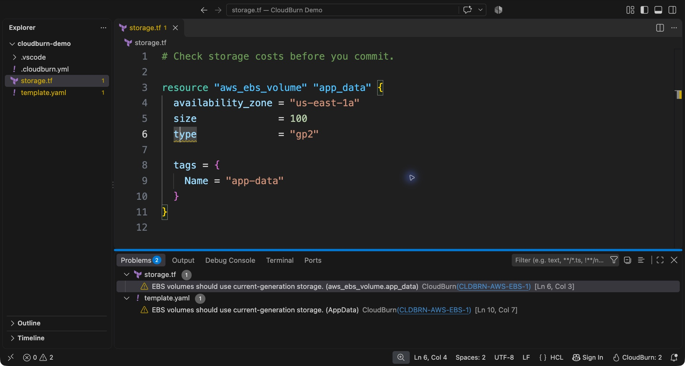
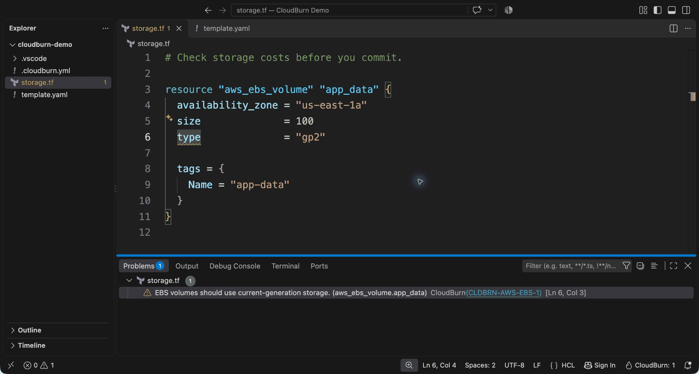
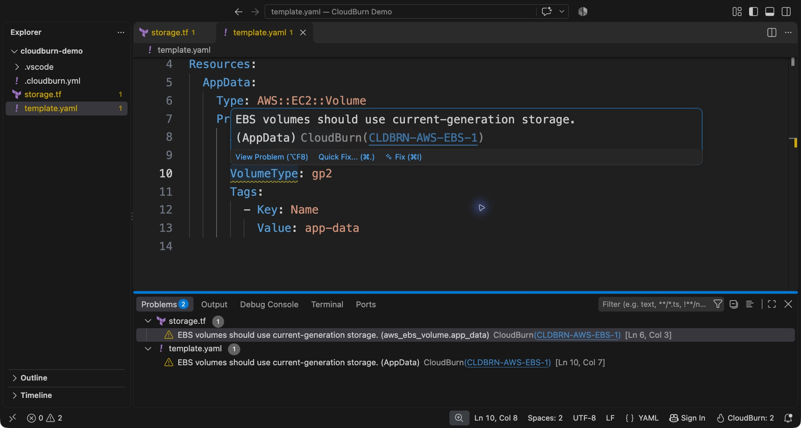

# CloudBurn for VS Code

Catch AWS cost waste before you commit. Check Terraform HCL (`.tf`) and CloudFormation JSON/YAML with the same CLI
rules and configuration you run in CI. Terraform JSON (`.tf.json`) is not currently parsed by the CLI.

---

<!-- TIP-LIST:START -->
> [!TIP]
> **Catch AWS waste before and after you deploy.**
>
> [CloudBurn](https://cloudburn.io) is a free, open-source CLI that checks your Terraform and CloudFormation for costly patterns before deploy, then finds the waste already running in your AWS account. Run it locally or in CI.
>
> <a href="https://github.com/towardsthecloud/cloudburn"></a>
>
> Want it managed across your AWS accounts? [CloudBurn Platform](https://cloudburn.io) runs it for you and keeps scan results in your own account. Join the waitlist for 30% off.
<!-- TIP-LIST:END -->



## Features

- Cost findings in the Problems panel and inline diagnostics, with links to rule explanations and remediation.
- Workspace-folder scans after saving Terraform, JSON, or YAML, debounced to avoid overlapping work.
- Editor file creations, renames, and deletions refresh already-scanned folders, including skipped-file warnings, even
  with save scans disabled. This includes folders whose explicit config path, or its symlink target, was created,
  renamed, or deleted. They never start a folder's first scan.
- Saving a file referenced by an explicit config path refreshes each referencing folder with save scans enabled,
  including explicit symlink aliases. Without an explicit path, saving `.cloudburn.yml` or `.cloudburn.yaml` in a
  folder or one of its ancestor directories refreshes that folder. A discovered config that is a symlink is matched by
  its own path, not its target; set `cloudburn.configPath` to keep a shared config outside the workspace current.
- **CloudBurn: Scan Workspace** scans every local folder in a multi-root workspace.
- Overlapping workspace folders share one scan using the outermost folder's settings, avoiding duplicate findings.
- The status bar shows findings or an incomplete scan. **CloudBurn: Show Output** opens scan details.
- Existing rule configuration and inline suppressions remain owned by the CLI.

Scans run locally. No AWS account, credentials, API key, or CloudBurn subscription is required. The extension does
not upload source files or collect telemetry, and it does not automatically change infrastructure.

## Get started

1. Install the [CloudBurn CLI](https://cloudburn.io/docs/cli/getting-started):

   ```bash
   brew install towardsthecloud/tap/cloudburn
   ```

   Or, with Node.js 24+: `npm install --global cloudburn`.
2. Install the local VSIX with **Extensions: Install from VSIX**. Marketplace publication is pending.
3. Open and trust a workspace folder. Run **CloudBurn: Scan Workspace**, or save a `.tf`, `.json`, `.yml`, or `.yaml`
   file to scan its containing folder.
4. Open Problems. Select a finding to navigate to the resource; click its rule ID for the explanation and fix.

A Terraform volume with `type = "gp2"` produces `CLDBRN-AWS-EBS-1`. After reviewing the rule and changing it to `gp3`,
save to rerun the scan and clear the finding. High-severity findings appear as errors; medium and low as warnings.
Findings without source locations appear at the workspace folder as warnings or errors according to rule severity.
Skipped files and failed scans appear as workspace warnings and in Output. Partial scans never appear as clean scans.

### See it in action

Change `gp2` to `gp3`, then save. CloudBurn reruns the CLI against the saved workspace and clears the warning.
This short animation shows the manual edit, save, and completed scan in a real VS Code temporary profile.



CloudFormation gets the same checks. Open an inline finding to see its rule ID and follow the link for remediation.



## Settings

| Setting                | Default     | Purpose                                                    |
| ---------------------- | ----------- | ---------------------------------------------------------- |
| `cloudburn.scanOnSave` | `true`      | Scan the containing folder after saving a supported file.  |
| `cloudburn.executable` | `cloudburn` | Executable on PATH, or an absolute executable path.        |
| `cloudburn.arguments`  | `[]`        | Launcher arguments before `--format json scan <folder>`.   |
| `cloudburn.configPath` | `""`        | Explicit config path, relative to each folder or absolute. |

An empty `configPath` preserves the CLI's discovery of `.cloudburn.yml` or `.cloudburn.yaml` from the workspace folder.
Use an explicit path when the editor inherits a CI environment. Saving a configured file refreshes each referencing
folder that has `scanOnSave` enabled, including symlink aliases, custom names, or files outside the workspace folders.
Separate workspace folders can have their own settings.
When folders overlap, the outermost folder owns the scan and its settings, including save scans and the config path.
See the [CLI configuration guide](https://cloudburn.io/docs/cli/configuration) for rule selection and suppressions.
Changing `scanOnSave` preserves current findings. Turning it off cancels only pending save scans. A refresh started by a
file change, a setting change, or **CloudBurn: Scan Workspace** still completes, even when a save interrupts it.
Changing the launcher, arguments, or config path rescans folders that have already been scanned.

The CLI must be installed on the **extension host**: your computer, SSH host, container, or Codespace running the
workspace extension. Virtual workspaces are unsupported. Scans read saved files, not unsaved buffers. Existing CDK
CloudFormation output can be scanned; the extension does not run `cdk synth` or map findings back to CDK source.

### Local builds and Windows npm installations

Launch the CLI JavaScript with a Node.js 24+ executable to avoid shell wrappers such as `.cmd` files:

```json
{
  "cloudburn.executable": "/absolute/path/to/node",
  "cloudburn.arguments": ["/absolute/path/to/cloudburn/packages/cloudburn/dist/cli.js"]
}
```

On Windows, use `node.exe` and the npm-installed `cloudburn/dist/cli.js`; `npm root --global` identifies the parent
directory. Escape backslashes in JSON paths. Arguments are passed directly; shell syntax is unsupported.
If the CLI is not found, set its absolute path. For errors or the 60-second scan deadline, open Output and try the
same scan in a terminal. CLI output is limited to 16 MiB per scan.

## Run the same checks in CI

**CloudBurn: Run These Checks in CI** opens the [GitHub Action guide](https://cloudburn.io/docs/cli/github-action).
Keep rule configuration in your repository so developers and code review use the same checks.

## Develop and package

From the monorepo root, use the pinned runtimes in
[local development](https://github.com/towardsthecloud/cloudburn/blob/main/docs/guides/local-development.md):

```bash
pnpm exec turbo run build --filter @cloudburn/vscode
pnpm exec turbo run test:e2e --filter @cloudburn/vscode
pnpm exec turbo run package:vsix --filter @cloudburn/vscode
```

The workspace package is `@cloudburn/vscode`. Its build generates `dist/vscode/` with the public extension name
`cloudburn-vscode`, the source package version, and publisher `dannysteenman`. Editor tests and packaging use this
generated directory; edit the source manifest and listing assets rather than the generated files.

Packaging requires `vsce` (`npm install --global @vscode/vsce`) and creates `packages/vscode/dist/cloudburn.vsix`.
Only the manifest, README, changelog, license, icon, README images/demo, and extension bundle ship.
The CLI is installed separately; SDK code, AWS libraries, test runners, and workspace dependencies stay out of the VSIX.
Packaging resolves README image links to this package's media on GitHub `main`; merge the assets before publishing.
See the [capture notes](https://github.com/towardsthecloud/cloudburn/blob/main/packages/vscode/media/README.md)
to refresh the screenshots and animation.

E2E tests download VS Code 1.100.3 and run real editor commands against the built CLI in temporary workspaces. They
start with empty folders and verify the first plaintext Terraform save without a Terraform language extension.
Linux uses `xvfb-run` when no display is available. Set `CLOUDBURN_VSCODE_EXECUTABLE` to test another installed editor.
Temporary workspaces are removed after each run. The config-alias regression probes alternate-case paths and logs a
skip on case-sensitive filesystems.

Release publishing follows the scoped `@cloudburn/vscode@<version>` tag after Changesets versioning. The release
workflow validates and packages once, then uploads the same VSIX to Visual Studio Marketplace and Open VSX using
`VSCE_TOKEN` and `OPEN_VSX_TOKEN` repository Actions secrets. See the
[release guide](https://github.com/towardsthecloud/cloudburn/blob/main/docs/guides/releasing.md#vs-code-extension)
for publisher setup and retries.
